# ممیزی معماری اطلاعات و نقشه سایت Oxenn / Seorchable

- تاریخ بررسی: ۲۰۲۶-۱۰-۲۹
- شاخه ممیزی: `docs/site-map-and-product-information-architecture`
- شاخه مبنا: `main`
- commit مبنا: `0a85219c90ccba91d0f796dc6cdd344d84b6e003`
- نوع اقدام: بررسی و مستندسازی فقط؛ هیچ صفحه، مسیر برنامه یا رفتار اجرایی در این شاخه تغییر نکرده است.

## 1. تصمیم‌های معماری که باید رعایت شوند

1. «راهکارها و خدمات» فقط سطح معرفی، توضیح ارزش، مخاطب هدف، موارد استفاده، وضعیت عرضه و CTA است. کار واقعی با ابزارها در داشبورد انجام می‌شود.
2. همه ابزارهای رایگان و پولی در یک **کاتالوگ خدمات داشبورد** فهرست می‌شوند؛ تفکیک رایگان/پولی با فیلتر، برچسب و مجوز انجام می‌شود، نه با چند مرکز ابزار مجزا.
3. SEO، AEO و GEO خانواده‌های محصول/ابزار در داشبورد هستند؛ صفحه عمومی آن‌ها فقط معرفی و هدایت به داشبورد است.
4. Digital Benchmark Twin (DBT) هسته مدل‌سازی و مقایسه برند/وب‌سایت/حضور واقعی با دوقلوی دیجیتال است.
5. موتور تحلیل فاصله میان وضعیت واقعی و DBT با نام پیشنهادی **Digital Twin Gap Analyzer (DTGA)** و نام فارسی «تحلیل‌گر شکاف دوقلوی دیجیتال» ارائه می‌شود. این نام، نقش ابزار را از یک پردازشگر مبهم به یک قابلیت قابل سنجش روشن می‌کند.
6. خدمات زیرساخت مدل‌های زبانی و ابزارهای هوش مصنوعی یک خانواده محصول مستقل با صفحه معرفی عمومی و فضای مدیریت متناظر در داشبورد خواهند داشت.
7. برای هر قابلیت «موجود»، «در حال توسعه» یا «برنامه‌ریزی‌شده» صفحه یا مقصد مشخص و پیوند قابل مشاهده وجود دارد. صفحه‌های برنامه‌ریزی‌شده باید وضعیت عرضه را صریح اعلام کنند و نباید وانمود کنند که قابلیت عملیاتی است.
8. نقشه معماری و ناوبری با XML sitemap یکی نیست. هر دو لازم‌اند، اما sitemap موتور جست‌وجو فقط URLهای عمومیِ آماده ایندکس را می‌گیرد.

## 2. نتیجه ممیزی وضعیت فعلی مخزن

### 2.1 مسیرهای موجود

از درخت مخزن در commit مبنا، ۵۸ فایل صفحه‌ای در `src/app/[locale]` شناسایی شد: ۳۴ مسیر داشبورد و ۲۴ مسیر غیر‌داشبورد. شمارش مسیرها اثبات پیاده‌سازی کامل یا آماده‌بودن تجاری هر قابلیت نیست؛ فقط وجود route/file را تأیید می‌کند.

**صفحات عمومی فعلی**
- خانه: `/[locale]`
- قابلیت‌ها: `/[locale]/features`
- راهکارها: `/[locale]/solutions`
- معرفی‌های راهکار: `/[locale]/solutions/aeo`, `/[locale]/solutions/geo`, `/[locale]/solutions/protection`, `/[locale]/solutions/radar`
- صنایع: `/[locale]/industries`
- تعرفه: `/[locale]/pricing`
- درباره ما: `/[locale]/about`
- تماس: `/[locale]/contact`
- منابع: `/[locale]/resources`
- وبلاگ: `/[locale]/blog`
- مستندات: `/[locale]/docs` و `/[locale]/docs/[slug]`
- حریم خصوصی: `/[locale]/privacy`

**ورود، حساب و صفحات عملیاتی**
- `/[locale]/login`
- `/[locale]/register`
- `/[locale]/forgot-password`
- `/[locale]/verify-email`
- `/[locale]/profile`
- `/[locale]/settings`
- `/[locale]/invoice`
- `/[locale]/design-system/tokens`

**مسیرهای داشبورد فعلی**
- نمای کلی: `/dashboard`
- AEO: `/dashboard/aeo/audits`, `/dashboard/aeo/content`, `/dashboard/aeo/playground`
- تحلیل‌ها: `/dashboard/analytics`, `/dashboard/analytics/llm`, `/dashboard/analytics/llm-bias`
- ممیزی: `/dashboard/audits`, `/dashboard/audits/[id]`, `/dashboard/audit/free`, `/dashboard/audit/premium`
- برند و استناد: `/dashboard/brand-monitoring`, `/dashboard/brand/citations`
- رقبا: `/dashboard/competitive`, `/dashboard/competitors`, `/dashboard/competitors/radar`
- محتوا: `/dashboard/content`, `/dashboard/content/studio`, `/dashboard/content/ingestion`
- دانش و داده: `/dashboard/entities`, `/dashboard/entities/graph`, `/dashboard/graph`, `/dashboard/ingest`, `/dashboard/ingestion`, `/dashboard/intelligence`, `/dashboard/query`, `/dashboard/rag`
- SEO فنی و طرح‌واره: `/dashboard/seo/technical`, `/dashboard/seo/schema`, `/dashboard/optimization/technical`
- سایر: `/dashboard/services`, `/dashboard/reports`, `/dashboard/billing`, `/dashboard/settings`

### 2.2 وضعیت واقعی sitemap

در درخت شاخه مبنا، route یا فایل اجرایی برای `sitemap.xml` / `src/app/sitemap.ts` و نیز route اجرایی `robots.txt` / `src/app/robots.ts` پیدا نشد. سند `docs/architecture/SITEMAP_AND_ROUTE_SPECIFICATION.md` موجود است، اما خودش تصریح می‌کند که blueprint برنامه‌ریزی است و قرار نیست در آن task کد برنامه تغییر کند؛ بنابراین وجودش به معنی وجود sitemap فعال نیست.

در نتیجه، **sitemap اجرایی در مخزن تأیید نشده است**. قبل از پیاده‌سازی XML sitemap باید canonical routeها، redirectها، وضعیت صفحه‌ها، localeها و سیاست noindex نهایی شوند.

### 2.3 ایرادهای مشاهده‌شده که بر نقشه اثر می‌گذارند

- فهرست ناوبری در چند جا مستقلاً تعریف شده و مقصدهای هم‌نام همیشه به صفحه درست نمی‌رسند.
- چند مسیر قدیمی داشبورد به‌جای redirect، کامپوننت مسیر دیگری را دوباره render می‌کنند؛ مانند `/dashboard/rag`, `/dashboard/ingest`, `/dashboard/graph` و `/dashboard/competitors`.
- `/settings` در سند معماری به پروفایل قابل redirect معرفی شده، اما کد صفحه فعلی مستقل است؛ تصمیم canonical باید اجرایی شود.
- footer صفحاتی مثل «Careers»، «Case Studies»، «Industry Benchmarks» و «Changelog & Roadmap» را به مقصدهای عمومی و کلی هدایت می‌کند، نه صفحات اختصاصی.
- چند slug لینک مستندات با `DOCS_INDEX` تطبیق دقیق ندارند. قبل از sitemap باید لینک‌ها از registry واقعی ساخته شوند و هر slug در build/test اعتبارسنجی شود.
- metadata عمومی در locale layout برای همه صفحات به‌صورت ثابت نوشته شده و عنوان/description اختصاصی و hreflang/canonical سراسری برای همه صفحات اثبات نشده است.
- ابزار رایگان در صفحه خانه anchor دارد، اما کاتالوگ یکپارچه ابزارهای رایگان و پولی در داشبورد وجود ندارد.
- مسیرهای اختصاصی داشبورد برای DBT، تحلیل شکاف، ساخت برنامه اجرایی، اجرای برنامه و چت چندمدلی در inventory فعلی پیدا نشدند.
- صفحه مستقل خدمات سازمانی و صفحه دموی داشبورد نیز در inventory فعلی وجود ندارند.
- `/privacy` به‌تنهایی برای تفکیک صفحه حریم خصوصی، شرایط استفاده، سیاست کوکی و شرایط خدمات کافی نیست؛ باید محتوا و URLهای canonical از هم تفکیک شوند.

## 3. نقشه سطح اول پیشنهادی

ساختار ناوبری عمومی مطابق درخواست مالک محصول:

1. **خانه** — `/[locale]`
2. **قابلیت‌ها** — `/[locale]/features`: ارزش و کاربرد قابلیت‌ها به تفکیک نوع مشتری/مارکت هدف، بدون اجرای ابزار
3. **راهکارها و خدمات** — `/[locale]/solutions`: کاتالوگ معرفی همه سرویس‌ها و ابزارها، همراه وضعیت عرضه و لینک به ابزار متناظر داخل داشبورد
4. **خدمات سازمانی** — `/[locale]/enterprise` (پیشنهادی، مسیر جدید): زیرساخت مدل‌های زبانی، API inference/serving، زیرساخت ابزارهای AI، استقرار، امنیت، کنترل دسترسی، مشاهده‌پذیری، قرارداد/SLA و درخواست مشاوره
5. **تعرفه خدمات** — `/[locale]/pricing`
6. **درباره ما** — `/[locale]/about`
7. **تماس با ما** — `/[locale]/contact`
8. **مستندات** — `/[locale]/docs`
9. **وبلاگ** — `/[locale]/blog`
10. **قوانین و مقررات** — `/[locale]/legal` (پیشنهادی، مسیر جدید) با پیوندهای جداگانه به `/privacy`, `/terms` و در صورت نیاز `/cookies`
11. **ورود / ثبت‌نام** — `/[locale]/login` و `/[locale]/register`
12. **دموی داشبورد** — `/[locale]/demo` (پیشنهادی، مسیر جدید؛ دموی امن با داده نمونه و بدون افشای اطلاعات واقعی)
13. **خدمات رایگان** — CTA به کاتالوگ متمرکز `/[locale]/dashboard/tools?access=free` با ورود/ثبت‌نام رایگان یا دسترسی محدود مهمانِ کنترل‌شده

**Product** به‌عنوان دسته محصول در معماری محتوا حفظ می‌شود و بخش جداگانه زیرساخت هوش مصنوعی زیر آن قرار می‌گیرد؛ برای جلوگیری از شلوغی navbar، دسترسی به صفحات جزئی از منوی «خدمات سازمانی» و hub محصولات امکان‌پذیر است:
- `/[locale]/product` — نمای کلی خانواده محصولات
- `/[locale]/product/llm-infrastructure` — زیرساخت سرو و اجرای مدل‌های زبانی
- `/[locale]/product/ai-tooling` — پلتفرم/ابزارهای AI و مدیریت اتصال ابزارها
- `/[locale]/product/api-platform` — API، کلیدها، سهمیه، هزینه و مستندات توسعه‌دهندگان

این صفحات عمومی فقط توضیح می‌دهند و CTA می‌دهند؛ سرویس واقعی از داشبورد/کنسول سازمانی مصرف می‌شود.

## 4. دسته‌بندی کامل خدمات در راهکارها و داشبورد

قاعده: هر ردیف زیر باید یک صفحه معرفی عمومی با لینک به یک route داشبورد داشته باشد. اگر route ابزار هنوز آماده نیست، route مقصد ساخته شود و صفحه به‌روشنی برچسب «در حال توسعه» یا «برنامه‌ریزی‌شده» بگیرد. route برنامه‌ریزی‌شده نباید نتیجه ساختگی یا دکمه عملیاتی غیرواقعی ارائه دهد.

### 4.1 هسته Digital Benchmark Twin و gap analysis

| خدمت | صفحه معرفی عمومی | ابزار متمرکز داشبورد | وضعیت در inventory فعلی |
|---|---|---|---|
| Digital Benchmark Twin (DBT) | `/solutions/digital-benchmark-twin` | `/dashboard/twin` | برنامه‌ریزی‌شده؛ route فعلی پیدا نشد |
| منابع داده و مدل برند/وب‌سایت | `/solutions/brand-data-ingestion` | `/dashboard/twin/sources` | بخشی از ingest موجود است؛ تطبیق DBT لازم |
| مقایسه داده واقعی با DBT | `/solutions/twin-comparison` | `/dashboard/twin/compare` | برنامه‌ریزی‌شده |
| تحلیل‌گر شکاف دوقلوی دیجیتال (DTGA) | `/solutions/digital-twin-gap-analyzer` | `/dashboard/twin/gaps` | برنامه‌ریزی‌شده |
| اولویت‌بندی شکاف‌ها و فرصت‌ها | `/solutions/gap-prioritization` | `/dashboard/twin/opportunities` | برنامه‌ریزی‌شده |

### 4.2 جست‌وجو و مدل‌های هوش مصنوعی

| خدمت | صفحه معرفی عمومی | ابزار متمرکز داشبورد | وضعیت در inventory فعلی |
|---|---|---|---|
| گفت‌وگو با مدل‌های هوش مصنوعی | `/solutions/ai-model-chat` | `/dashboard/ai/chat` | مسیر عمومی چت اختصاصی پیدا نشد؛ Query/RAG موجود است اما معادل خودکار چت چندمدلی نیست |
| آزمایش/مقایسه مدل‌ها و prompt | `/solutions/model-evaluation` | `/dashboard/ai/model-lab` | بخشی از prompt playground موجود؛ دامنه نهایی باید تثبیت شود |
| Prompt/query monitoring | `/solutions/prompt-monitoring` | `/dashboard/ai/prompts` | مسیرهای query/playground موجود؛ canonicalization لازم |
| تحلیل پاسخ و استناد مدل‌ها | `/solutions/ai-visibility` | `/dashboard/aeo/audits` و `/dashboard/brand/citations` | routeها موجود؛ تکمیل وضعیت عملکردی لازم |
| هوشمندی رقابتی | `/solutions/competitive-intelligence` | `/dashboard/competitors/radar` | مسیرهای مشابه موجود؛ canonical route واحد لازم |

### 4.3 SEO، AEO و GEO — همه داخل داشبورد

| خانواده/خدمت | صفحه معرفی عمومی | ابزار متمرکز داشبورد | وضعیت در inventory فعلی |
|---|---|---|---|
| SEO overview و ابزارها | `/solutions/seo` | `/dashboard/seo` | hub اختصاصی پیشنهاد می‌شود؛ زیرصفحات فنی/schema موجود |
| Technical SEO audit | `/solutions/technical-seo` | `/dashboard/seo/technical` | صفحات ابزار موجود |
| Schema و structured data | `/solutions/structured-data` | `/dashboard/seo/schema` | ابزار موجود |
| AEO | `/solutions/aeo` | `/dashboard/aeo` و زیرصفحات audits/content/playground | زیرصفحات موجود؛ hub باید روشن شود |
| AEO content intelligence | `/solutions/aeo-content` | `/dashboard/aeo/content` | route موجود |
| GEO | `/solutions/geo` | `/dashboard/geo` | route داشبوردی اختصاصی در inventory فعلی پیدا نشد |
| تحلیل رقابت/سهم صدا | `/solutions/brand-visibility-analytics` | `/dashboard/analytics/llm` | route موجود؛ روابط منو باید یکپارچه شود |
| تولید/بهینه‌سازی محتوا | `/solutions/content-optimization` | `/dashboard/content/studio` | route موجود |
| ingest محتوا و اسناد | `/solutions/knowledge-ingestion` | `/dashboard/content/ingestion` | route موجود؛ مسیرهای قدیمی ingest باید redirect شوند |
| گراف دانش و موجودیت‌ها | `/solutions/knowledge-graph` | `/dashboard/entities/graph` | route موجود؛ aliasهای graph باید canonical شوند |
| گزارش‌های مدیریتی | `/solutions/executive-reporting` | `/dashboard/reports` | route موجود |

### 4.4 برنامه‌ریزی و اجرای عمل

| قابلیت | صفحه معرفی عمومی | ابزار متمرکز داشبورد | وضعیت در inventory فعلی |
|---|---|---|---|
| ساخت برنامه اجرایی اولویت‌بندی‌شده | `/solutions/execution-planning` | `/dashboard/plans` | برنامه‌ریزی‌شده؛ route پیدا نشد |
| جزئیات، وابستگی‌ها و معیار موفقیت برنامه | `/solutions/action-plan-management` | `/dashboard/plans/[planId]` | برنامه‌ریزی‌شده |
| اجرای برنامه و گردش کار | `/solutions/plan-execution` | `/dashboard/executions` | برنامه‌ریزی‌شده |
| رصد وضعیت وظایف و نتایج | `/solutions/optimization-tracking` | `/dashboard/executions/[runId]` | برنامه‌ریزی‌شده |
| تنظیمات ابزارها و اتصال‌ها | `/solutions/ai-tool-configuration` | `/dashboard/settings/tools` | تنظیمات کلی موجود؛ صفحه اختصاصی ابزارها پیدا نشد |

### 4.5 زیرساخت مدل و ابزارهای هوش مصنوعی (Product / Enterprise)

| محصول | صفحه عمومی Product | کنسول داشبورد | وضعیت در inventory فعلی |
|---|---|---|---|
| LLM serving / inference infrastructure | `/product/llm-infrastructure` | `/dashboard/enterprise/llm-infrastructure` | محصول عمومی و کنسول اختصاصی پیدا نشد |
| AI tool runtime / tool registry | `/product/ai-tooling` | `/dashboard/enterprise/ai-tools` | محصول عمومی و کنسول اختصاصی پیدا نشد |
| API platform و کلیدهای دسترسی | `/product/api-platform` | `/dashboard/developer/api-keys` | بعضی endpointهای API موجودند؛ صفحه کنسول محصول باید بررسی/تکمیل شود |
| provider/model configuration | `/product/model-management` | `/dashboard/settings/models` | باید با وضعیت پیکربندی واقعی providerها تطبیق داده شود |
| مصرف، هزینه و quota | `/product/usage-governance` | `/dashboard/enterprise/usage` | billing موجود؛ تجمیع API/AI usage نیازمند بررسی است |
| امنیت، دسترسی، audit و SLA | `/enterprise/security-and-governance` | `/dashboard/enterprise/security` | صفحه محصول و کنسول اختصاصی پیدا نشد |

### 4.6 خدمات فرعی و زیرساختی داشبورد

تمام این موارد باید در کاتالوگ متمرکز داشبورد قابل کشف باشند:
- نمای کلی workspace؛
- catalog با فیلتر «رایگان / پولی / در دسترس برای طرح من / در حال توسعه / برنامه‌ریزی‌شده»؛
- مدیریت برند، سایت، workspace و منابع ورودی؛
- رقبا، استنادها، analytics و گزارش‌ها؛
- تنظیمات کاربری و workspace، تنظیمات ابزارها و providerها؛
- اشتراک، billing، quota، usage و API keys؛
- مستندات مرتبط با هر ابزار و کمک درون‌محصولی.

صفحات موجود در این بخش در حال حاضر شامل `/dashboard`, `/dashboard/services`, `/dashboard/settings`, `/dashboard/billing`, `/dashboard/reports`, `/dashboard/brand-monitoring`, `/dashboard/brand/citations`, `/dashboard/analytics/*` هستند. وجود مسیر، تکمیل کارکرد را اثبات نمی‌کند؛ از جمله صفحه عمومی تنظیمات فعلی متن «در دست توسعه» نشان می‌دهد.

## 5. معماری منوها و مالکیت صفحه

- **منوی عمومی** فقط مسیرهای عمومی سطح یک و معرفی محصول را دارد.
- **Solutions** برای هر سرویس یک کارت/صفحه معرفی دارد؛ CTA آن به route ابزار داخل Dashboard می‌رود.
- **Product / Enterprise** زیرساخت مدل‌های زبانی و ابزارهای AI را معرفی می‌کند و به کنسول سازمانیِ داشبورد وصل می‌شود.
- **Dashboard Service Catalog** تنها نقطه کشف و اجرای ابزارهای رایگان و پولی است. داشبورد منوی دسته‌بندی‌شده و جست‌وجوی سراسری دارد و وضعیت هر قابلیت از registry مرکزی می‌آید.
- مسیرهای احراز هویت جدا از shell بازاریابی و shell فضای کاری هستند.
- یک registry واحد باید route، عنوان فارسی/انگلیسی، توضیح، طبقه محصول، دسترسی، وضعیت توسعه، canonical route و target داشبورد را تعریف کند؛ navbar، footer، catalog و sitemap از همان registry مشتق شوند.
- مسیرهای alias یا redirect می‌شوند یا تا زمان مهاجرت با canonical URL صریح معرفی می‌شوند؛ نباید چند صفحه هم‌محتوا در sitemap قرار گیرند.

## 6. سیاست وضعیت عرضه و SEO

سه وضعیت محتوا/عرضه باید استاندارد شوند:

- **موجود (Available):** صفحه معرفی، مستندات استفاده، CTA معتبر و route داشبورد عملیاتی دارد. فقط در این وضعیت، پس از تأیید SEO، امکان قرار گرفتن در sitemap عمومی وجود دارد.
- **در حال توسعه (In development):** صفحه و لینک دارد، وضعیت و محدوده قابل استفاده/غیرقابل استفاده را مشخص می‌کند، CTA اجرای قابلیت را disabled یا ثبت علاقه‌مندی می‌کند و وعده عملیاتی نادرست نمی‌دهد. تا وقتی محتوای ارزشمند و هدف جست‌وجویی ندارد، noindex می‌ماند.
- **برنامه‌ریزی‌شده (Planned):** صفحه معرفی شفاف، مسئله‌ای که حل می‌کند، مخاطب، وضعیت، و لینک بازگشت/درخواست دسترسی دارد. route در نقشه معماری و منو ثبت می‌شود، اما نباید در XML sitemap ایندکس‌پذیر وارد شود تا صفحه ارزشمند واقعی آماده باشد.

برای localeها:
- هر صفحه عمومی باید عنوان، توضیح و محتوا را با locale URL تطبیق دهد.
- canonical هر صفحه باید به نسخه غیرپارامتری و درست همان زبان اشاره کند؛ UTM و queryهای جست‌وجو URL ایندکس‌پذیر جدید تولید نکنند.
- `hreflang=en`, `hreflang=fa` و `x-default` فقط بین ترجمه‌های متناظر واقعی درج شوند.
- مسیرهای dashboard، account، invoice، demo خصوصی و ابزارهای اجرایی باید مطابق سیاست دسترسی و noindex مدیریت شوند؛ مسیر API و فایل‌ها نباید به‌عنوان صفحات محتوایی sitemap تولید شوند.
- sitemap XML باید فقط routeهای canonical عمومی و مجاز به ایندکس را تولید کند؛ sitemap عمومی جایگزین نقشه کامل محصول نیست.

## 7. ساختار پیشنهادی اجرای کار

1. تصویب معماری اطلاعات فوق و تصمیم درباره نام‌ها و routeهای canonical.
2. ساخت route registry مرکزی شامل تمام قابلیت‌های موجود، در حال توسعه و برنامه‌ریزی‌شده.
3. همسان‌سازی navbar، footer، catalog داشبورد و لینک‌های مستندات با registry.
4. ساخت صفحه‌های جدید/مقصدهای داشبورد برای DBT، DTGA، چت مدل‌ها، برنامه‌ریزی و اجرای برنامه و خدمات زیرساختی؛ هر صفحه با وضعیت عرضه واقعی.
5. انتقال همه ابزارهای رایگان و پولی به catalog داشبورد و ایجاد demo مستقل با داده نمونه.
6. اجرای redirectهای canonical، حذف یا alias کردن routeهای تکراری و آزمون تمام پیوندها.
7. پیاده‌سازی metadata اختصاصی، canonical/hreflang، robots و XML sitemap پویا.
8. آزمون خودکار: route existence، link target existence، locale parity، status badge correctness، noindex boundaries، duplicate/canonical route، sitemap inclusion/exclusion و accessibility منو.
9. آزمون مرورگر فارسی/انگلیسی و تم روشن/تاریک در viewport موبایل و دسکتاپ.

## 8. معیارهای پذیرش

- هر خدمت/ابزار در registry مرکزی، صفحه معرفی عمومی و مقصد مشخص داشبورد دارد.
- هر ابزار با وضعیت Planned یا In development همین وضعیت را به زبان فعلی کاربر نشان می‌دهد.
- همه ابزارهای رایگان/پولی از Dashboard Service Catalog قابل پیدا کردن هستند؛ صفحه public صرفاً معرفی یا دمو است.
- ابزارهای SEO/AEO/GEO در فضای کاری داشبورد سازمان‌دهی شده‌اند، نه به‌عنوان محل اجرای کار در بخش public Solutions.
- زیرساخت LLM و AI tooling یک بخش مستقل Product/Enterprise با صفحات معرفی و کنسول داشبوردی دارد.
- هیچ مقصد منو به صفحه نامرتبط، slug نامعتبر یا alias بدون سیاست canonical منتهی نمی‌شود.
- sitemap اجرایی از registry ساخته می‌شود و مسیرهای خصوصی، aliasها، routeهای planned و صفحات کم‌محتوا را ایندکس نمی‌کند.
- فارسی و انگلیسی برای تمام صفحات عمومی و داشبورد از نظر مسیر، title, description, direction، لینک مقصد و تم روشن/تاریک تست شده‌اند.

**وضعیت این سند:** نتیجه ممیزی و پیشنهاد معماری است؛ هیچ route، sitemap، redirect یا UI در این شاخه پیاده‌سازی نشده است.

---

## 9. بازبینی تکمیلی بر اساس کد واقعی شاخه main

- commit بررسی‌شده: `0a85219c90ccba91d0f796dc6cdd344d84b6e003`
- تاریخ بازبینی تکمیلی: ۲۰۲۶-۱۰-۲۹
- روش: بررسی درخت کامل مخزن، فایل‌های route، لایه locale، provider زبان/تم، هدر و فوتر، کاتالوگ مستندات، و اسناد معماری/نقشه راه.
- محدودیت: این مرحله ممیزی ایستا است؛ کلیک واقعی در مرورگر، پاسخ HTTP همه URLها، و آزمون بصری تمام viewportها در این مرحله اجرا نشده است. مواردی که از کد قابل اثبات‌اند از فرضیه‌های نیازمند آزمون جدا شده‌اند.

### 9.1 تأیید نقشه فعلی و وضعیت فنی SEO

در commit بررسی‌شده، در مجموع **۵۸ فایل page در مسیر `src/app/[locale]`** وجود دارد: **۳۴ مسیر داشبورد** و **۲۴ مسیر غیرداشبورد**. این عدد تعداد فایل‌های page است؛ نه تعداد همه URLهای نهایی، چون localeها و پارامترهای پویا می‌توانند URLهای بیشتری ایجاد کنند.

درخت کامل مخزن هیچ‌یک از این موارد را ندارد:
- `src/app/sitemap.ts` یا route متناظر `sitemap.xml`
- `src/app/robots.ts` یا فایل `robots.txt`
- فایل مستقل اجرایی برای تولید canonical/hreflang سراسری

بنابراین sitemap و robots اجرایی وجودشان در مخزن تأیید نمی‌شود؛ سند معماری موجود جایگزین route اجرایی نیست. فایل `src/proxy.ts` فقط برای مسیر دقیق `/` matcher دارد و آن را به `/fa` هدایت می‌کند؛ این proxy به‌خودی‌خود اعتبار locale را برای مسیرهای دیگر کنترل نمی‌کند.

در صفحات عمومی زیر، export مستقل `metadata` یا `generateMetadata` پیدا نشد: صفحه خانه، Features، Solutions، Solutions/GEO، Solutions/AEO، Industries، Pricing، About، Contact، Resources، Blog و Privacy. metadata مشترک در `src/app/[locale]/layout.tsx` تعریف شده است و عنوان پیش‌فرض/description آن فارسی و ثابت است. در این لایه canonical، `alternates.languages`/hreflang یا سیاست robots تعریف نشده است. تنظیم `metadataBase` به‌تنهایی canonical صفحه تولید نمی‌کند. نتیجه عملی: metadata یکتا برای هر صفحه و هر زبان هنوز اثبات نشده است.

### 9.2 ممیزی مقصدهای واقعی لینک‌ها

| محل | مقصد فعلی | یافته | اقدام پیشنهادی |
|---|---|---|---|
| `LandingHeader`، CTA «Login» | `/[locale]/dashboard` | مسیر ورود مستقل `/[locale]/login` وجود دارد؛ برچسب Login با مقصد dashboard هم‌خوان نیست. | مقصد CTA به login تغییر کند؛ مسیر بازگشت بعد از ورود به‌صورت صریح حفظ شود. |
| `LandingHeader`، «Pricing» | `/[locale]/#pricing` | anchor مربوط به `#pricing` در خانه وجود دارد، پس لینک فعلی از نظر anchor بی‌مقصد نیست؛ اما از route مستقل `/[locale]/pricing` عبور نمی‌کند. | یک رفتار canonical انتخاب شود: صفحه تعرفه یا بخش تعرفه خانه؛ navbar و footer یکسان عمل کنند. |
| فوتر، پنج پیوند مستندات | `introduction-to-brandgraph`, `infrastructure-architecture`, `ai-pipeline-architecture`, `multi-tenant-isolation`, `knowledge-graph-design` | هیچ‌یک slug دقیق موجود در `DOCS_INDEX` نیست و هیچ‌یک از نام فایل‌های Markdown مخزن نیز با این نام‌ها (حتی با نادیده‌گرفتن حروف بزرگ/کوچک) تطبیق ندارد. route مستندات محتوای فایل را با نام دقیق `${slug}.md` می‌یابد؛ در نتیجه این مقصدها به احتمال بسیار بالا و بر مبنای resolver فعلی خطای 404 می‌دهند. | پیوندها باید از registry واقعی مستندات تولید و در آزمون build اعتبارسنجی شوند؛ slug را دستی حدس نزنید. |
| فوتر، «Prompt Monitoring» | `/[locale]/dashboard` | مقصد کلی داشبورد است، نه ابزار مشخص؛ مسیرهایی مرتبط مانند `/dashboard/query` وجود دارد، اما معادل بودن معنایی باید تأیید شود. | مقصد دقیق ابزار بعد از تثبیت تعریف قابلیت تعیین شود. |
| فوتر، «AI Search Analytics» | `/[locale]/dashboard` | مقصد کلی است؛ `/dashboard/analytics/llm` و `/dashboard/analytics` وجود دارند. | به route تحلیلی canonical هدایت شود. |
| فوتر، «Careers» | `/[locale]/about` | صفحه اختصاصی فرصت‌های شغلی وجود ندارد؛ برچسب، مقصد اختصاصی را القا می‌کند ولی آن را باز نمی‌کند. | یا بخش واقعی Careers به About اضافه شود یا لینک تا آماده‌شدن مقصد حذف/تغییر نام یابد. |
| فوتر، «Case Studies» و «Industry Benchmarks» | `/[locale]/blog` | این برچسب‌ها به مقصد عمومی بلاگ می‌روند، نه مجموعه اختصاصی مطالعات موردی یا بنچ‌مارک. | فقط در صورت وجود محتوا/route واقعی صفحه اختصاصی بسازید؛ در غیر این صورت برچسب را به Blog/Insights تغییر دهید. |
| فوتر، «Changelog & Roadmap» | `/[locale]/dashboard` | مقصد با معنی برچسب هم‌خوان نیست و صفحه roadmap عمومی در inventory وجود ندارد. | پیوند را حذف/تغییرنام دهید یا پس از آماده‌شدن محتوای واقعی، مقصد مشخص ایجاد کنید. |
| فوتر، «Terms of Service» و «Compliance Stand» | `/[locale]/privacy` | هر دو به همان صفحه «حفاظت از داده/حریم خصوصی» می‌روند؛ route یا بخش مشخص برای شرایط استفاده/Compliance اثبات نشده است. | ساختار حقوقی و محتوای معتبر تعیین شود؛ هیچ صفحه حقوقی خالی یا متن ساختگی اضافه نشود. |
| فوتر، «Enterprise Solutions» | `/[locale]/contact` | راهکار سازمانی صفحه معرفی مستقل ندارد؛ لینک به فرم/صفحه تماس هدایت می‌کند. | تا زمان ایجاد صفحه محصول سازمانی، برچسب به «تماس برای خدمات سازمانی» تغییر کند؛ صفحه جدید فقط با محتوای اثبات‌پذیر ساخته شود. |

همچنین فوتر برای «Official SDK Library» و «Webhooks Stream» به مقصدهای مستندات نامنطبق اشاره می‌کند. پیوندهای بیرونی LinkedIn و X/Telegram در حال حاضر به دامنه‌های عمومی `linkedin.com` و `t.me` می‌روند، نه URL حساب رسمی برند؛ بنابراین نباید آنها را کانال تأییدشده برند معرفی کرد. در متن فوتر، عبارت `BrandGraph / seorchable.ir` نیز با نام غالب برند `Seorchable` یک‌دست نیست. عبارت اطمینان‌بخش «Enterprise System Channels Secure» بهتر است فقط در صورت وجود شواهد فنی قابل ارائه منتشر شود.

### 9.3 پورتال مستندات: شناسه‌های تکراری و resolver حساس به نام فایل

بررسی `src/lib/docsIndex.ts` تعداد **۴۹ ورودی ولی فقط ۴۶ slug یکتا** را نشان می‌دهد:
- `product` دو بار تکرار شده است.
- `architecture` سه بار تکرار شده است.

صفحه جزئیات از `DOCS_INDEX.find((topic) => topic.slug === slug)` استفاده می‌کند؛ بنابراین slug تکراری metadata اولین مورد را انتخاب می‌کند، در حالی که API متن مستند را با جست‌وجوی فایل `${slug}.md` پیدا می‌کند. این دو lookup ممکن است title/category و محتوای صفحه را ناهم‌خوان کنند. API مستندات همچنین پوشه `docs/project` را عمداً از جست‌وجوی فایل مستثنا می‌کند. مسیرهای مستندات باید از یک registry یکتا و canonical ساخته شوند؛ slug باید یکتا باشد و resolver همان شناسه را برای metadata و content به‌کار ببرد.

### 9.4 زبان، جهت و تم

- در `src/app/[locale]/layout.tsx` ویژگی‌های HTML اولیه از URL می‌آیند: `lang={locale}` و `dir={locale === "fa" ? "rtl" : "ltr"}`.
- در `ThemeProvider`، مقدار ذخیره‌شده `localStorage.language` پس از mount بر `initialLanguage` غلبه می‌کند. صفحه خانه متن را از locale مسیر می‌گیرد، در حالی که `LandingHeader` زبان را از `useTheme()` می‌خواند. بنابراین locale ذخیره‌شده می‌تواند عنوان/محتوای خانه و منو را ناهم‌زبان کند؛ مقدار اولیه `lang/dir` سند نیز با مقدار ذخیره‌شده تغییر می‌کند.
- صفحه Pricing، برخلاف صفحات عمومی اصلی بررسی‌شده، `LandingHeader` و `LandingFooter` را import نمی‌کند؛ همچنین رشته‌های آن از `useTheme().language` مشتق می‌شوند، نه مستقیم از locale URL. این صفحه در حال حاضر shell عمومی یکسانی با خانه و صفحه Features ندارد و در معرض همان ناهماهنگی locale است.
- صفحه مستندات از رنگ‌ها و سطوحی مانند `text-white`، `bg-slate-900` و `text-slate-300` به‌صورت ثابت استفاده می‌کند. سازگاری واقعی آن با تم روشن باید در آزمون بصری بررسی شود؛ بر اساس کد، تبعیت کامل آن از توکن‌های تم اثبات نشده است.
- کد خانه برای داشبوردهای نمایشی از عبارت `Mock Dashboard visualizations` استفاده می‌کند. شاخص‌ها، نمودارها و ادعاهای «real-time/live» یا هر ادعای تضمینی باید یا به منبع واقعی و قابل راستی‌آزمایی متصل شوند، یا به‌وضوح به‌عنوان نمونه/دمو برچسب بخورند. صرف نمایش تصویری، پیاده‌سازی عملیاتی را ثابت نمی‌کند.

این یافته‌ها در این مرحله فقط ثبت شده‌اند؛ زبان‌گردانی یا PR شماره ۹۸ در این شاخه اصلاح نمی‌شود.

### 9.5 ناسازگاری‌های سند معماری route با کد و نقشه راه

سند `docs/architecture/SITEMAP_AND_ROUTE_SPECIFICATION.md` مفید است، اما پیش از تبدیل‌شدن به منبع قابل‌اجرای route registry باید با کد و نقشه راه واقعی reconcile شود:

1. این سند مسیر اسناد منبع را `docs/roadmap/...` معرفی می‌کند، در حالی که مسیر واقعی آنها در مخزن `docs/project/roadmap/...` است. نسخه فعلی `docs/project/tasks/TASK13.0.md` الزام می‌کند route، محتوا، locale، SEO و همه مقصدهای منو از وضعیت واقعی مخزن بررسی شوند.
2. یک بخش از سند locale را به‌صورت `/[locale]/en` و `/[locale]/fa` توصیف می‌کند، اما ساختار واقعی `src/app/[locale]` و proxy از URLهایی مانند `/en` و `/fa` پشتیبانی می‌کنند؛ شکل nesting در عبارت فوق نادرست است.
3. ماتریس سند مسیر `/[locale]/dashboard/audit` را EXISTING می‌نامد، اما در درخت route فایل `dashboard/audit/page.tsx` وجود ندارد؛ فقط `audit/free` و `audit/premium` وجود دارند.
4. سند `/dashboard/ingestion` را canonical می‌داند، ولی `src/config/dashboardNavigation.ts` مقصد `/dashboard/content/ingestion` را عرضه می‌کند و هر دو route در درخت موجودند. قبل از هر redirect باید تصمیم canonical روشن و همه منوها/لینک‌ها با همان تصمیم هماهنگ شوند.
5. سند `/dashboard/graph` را به `/dashboard/entities` هدایت می‌کند، اما منوی داشبورد به `/dashboard/entities/graph` اشاره می‌کند. این تفاوت باید به‌صورت تصمیم route ثبت شود، نه با redirect حدسی.
6. سند فعلی `/[locale]/settings` را legacy و هدف را `/[locale]/profile` می‌داند، در حالی که route `/settings` واقعی و مستقل است و `/dashboard/settings` نیز تنظیمات workspace را دارد. نقش personal settings در برابر workspace settings باید روشن شود.
7. سند موجود یک «Read-Only Planning Blueprint» است، نه اثبات اجرای redirect یا route. وجود توصیه در سند به معنی اجرای آن در `next.config.ts` یا `src/proxy.ts` نیست.

**قاعده توقف:** تا زمانی که اختلاف‌های canonical بالا به یک ماتریس route واحد تبدیل نشده‌اند، پیاده‌سازی redirect دائمی، حذف route یا درج routeهای هدف در sitemap موتور جست‌وجو انجام نشود.

### 9.6 دیاگرام پیشنهادی معماری اطلاعات

در نمودار زیر `/[locale]` به یکی از دو locale موجود، یعنی `/fa` یا `/en` اشاره دارد. شاخه‌های «Target» پیشنهاد معماری‌اند و نباید تا زمان تأیید، محتوای معتبر و پیاده‌سازی واقعی به‌عنوان route موجود یا مقصد عملیاتی لینک شوند.

```mermaid
flowchart TD
    ROOT["/"] --> DEFAULT["/fa (redirect فعلی)"]
    DEFAULT --> LOCALE["Locale prefix: /fa یا /en"]

    LOCALE --> PUBLIC["Public marketing — index candidate"]
    PUBLIC --> HOME["/ — Home"]
    PUBLIC --> FEATURES["/features"]
    PUBLIC --> SOLUTIONS["/solutions"]
    SOLUTIONS --> AEO["/solutions/aeo"]
    SOLUTIONS --> GEO["/solutions/geo"]
    SOLUTIONS --> PROTECT["/solutions/protection"]
    SOLUTIONS --> RADAR["/solutions/radar"]
    PUBLIC --> INDUSTRIES["/industries"]
    PUBLIC --> PRICING["/pricing"]
    PUBLIC --> RESOURCES["/resources"]
    PUBLIC --> BLOG["/blog"]
    PUBLIC --> DOCS["/docs"]
    DOCS --> DOCDETAIL["/docs/[slug] — valid unique slugs only"]
    PUBLIC --> ABOUT["/about"]
    PUBLIC --> CONTACT["/contact"]
    PUBLIC --> PRIVACY["/privacy — current combined legal page"]

    LOCALE --> ACCESS["Authentication and account — noindex/access policy"]
    ACCESS --> LOGIN["/login"]
    ACCESS --> REGISTER["/register"]
    ACCESS --> RESET["/forgot-password"]
    ACCESS --> VERIFY["/verify-email"]
    ACCESS --> PROFILE["/profile"]
    ACCESS --> SETTINGS["/settings — canonical decision required"]
    ACCESS --> INVOICE["/invoice — verify access/noindex"]
    ACCESS --> TOKENS["/design-system/tokens — exclude from public sitemap"]

    LOCALE --> WORKSPACE["Authenticated workspace — noindex"]
    WORKSPACE --> DASH["/dashboard"]
    DASH --> CATALOG["/dashboard/services"]
    DASH --> AUDITS["/dashboard/audits and /dashboard/audits/[id]"]
    DASH --> SEO["SEO: /dashboard/seo/technical, /dashboard/seo/schema"]
    DASH --> AEOAPP["AEO: /dashboard/aeo/audits, /content, /playground"]
    DASH --> ANALYTICS["Analytics: /dashboard/analytics, /analytics/llm, /analytics/llm-bias"]
    DASH --> COMPETE["Competitive: /dashboard/competitive, /dashboard/competitors/radar"]
    DASH --> CONTENT["Content: /dashboard/content, /content/studio, /content/ingestion"]
    DASH --> KNOWLEDGE["Knowledge: /dashboard/entities, /entities/graph, /query, /intelligence"]
    DASH --> ADMIN["Reports, billing and workspace settings"]

    LOCALE -. "Target; add only with approved content/evidence" .-> TARGET["Product / Enterprise / Demo"]
    TARGET --> LLM["/product/llm-infrastructure"]
    TARGET --> AITOOLS["/product/ai-tooling"]
    TARGET --> APIS["/product/api-platform"]
    TARGET --> ENTERPRISE["/enterprise"]
    TARGET --> DEMO["/demo"]
    TARGET --> TWIN["Dashboard targets: DBT, DTGA, plans/executions"]

    LOCALE --> DISCOVERY["Search-engine discovery — not implemented"]
    DISCOVERY --> XML["/sitemap.xml — target"]
    DISCOVERY --> ROBOTS["/robots.txt — target"]
```

### 9.7 سیاست پیشنهادی برای XML sitemap و indexability

1. sitemap فقط از route registry canonical ساخته شود؛ پیمایش دستی یا فهرست مستقل در چند فایل منبع حقیقت ایجاد نکند.
2. در شروع، فقط صفحات عمومی موجود با محتوای اصیل و metadata اختصاصی نامزد index هستند: خانه، Features، Solutions و زیرصفحات واقعی آن، Industries، Pricing، About، Contact، Resources، Blog، صفحه مستندات و فقط slugهای مستندات معتبر. `/privacy` نیز فقط با محتوای حقوقی کامل و نهایی وارد شود.
3. `/[locale]/dashboard/*`، ورود/ثبت‌نام/بازیابی رمز/تأیید ایمیل، پروفایل، تنظیمات، invoice، صفحات ابزار داخلی و design tokens در XML sitemap عمومی قرار نگیرند. عدم حضور در sitemap به‌تنهایی جایگزین کنترل دسترسی یا `noindex` نیست.
4. برای هر صفحه عمومی ترجمه‌شده، title، description، canonical و hreflang باید از URL و locale واقعی مشتق شوند. `hreflang` فقط برای ترجمه متناظر واقعی درج شود؛ زبان فارسی یا انگلیسی صرفاً به دلیل وجود دو URL برای تمام صفحات قابل فرض نیست.
5. URLهای alias/redirect، پارامترهای غیرمحتوایی و صفحات Planned/Thin در sitemap وارد نشوند. صفحه «در حال توسعه» تنها وقتی indexable می‌شود که محتوای واقعاً مفید، metadata درست و وضعیت محصول صادقانه داشته باشد.
6. تا زمان تعیین canonical برای `/dashboard/ingestion`، `/dashboard/content/ingestion`، `/dashboard/graph`، `/dashboard/entities/graph` و `/settings`، این تصمیم‌ها در route registry با وضعیت `BLOCKED — CANONICAL DECISION REQUIRED` ثبت شوند.

### 9.8 ترتیب اقدام پس از تکمیل ممیزی

| اولویت | اقدام | دلیل |
|---|---|---|
| P0 | اصلاح مقصدهای لینک موجود و پنج slug شکسته مستندات؛ رفع slugهای تکراری | لینک‌های داخلی و محتوای مستندات مقصد معتبر ندارند. |
| P0 | توافق بر یک ماتریس canonical و legacy که با نقشه راه و منوها سازگار باشد | جلوگیری از redirect نادرست، حلقه redirect یا دو نسخه قابل ایندکس. |
| P1 | ساخت route registry یکتا شامل path، locale، title، description، status، auth/noindex، canonical و link target | منو، فوتر، مستندات، کاتالوگ و sitemap باید از یک داده مشترک مشتق شوند. |
| P1 | تکمیل metadata اختصاصی، canonical، locale alternates، robots و XML sitemap؛ همراه آزمون URL/locale | metadata فعلی در سطح layout عمومی و ثابت است. |
| P1 | همسان‌سازی locale URL با `ThemeProvider` و اطمینان از shell مشترک صفحات عمومی | جلوگیری از ناهم‌خوانی زبان و مقصد CTAها؛ اجرای اصلاح مربوط به PR #98 خارج از این شاخه می‌ماند. |
| P2 | افزودن صفحات معرفی Product/Enterprise/Demo یا ابزارهای DBT/DTGA فقط پس از تأیید دامنه و وجود محتوای واقعی | جلوگیری از مقصد ساختگی و ادعاهای محصولی بدون مدرک. |

**وضعیت اجرایی Part One:** این شاخه فقط گزارش ممیزی را تکمیل می‌کند. هیچ route برنامه، metadata، proxy، redirect، فایل sitemap/robots، UI یا رفتار PR #98 در این مرحله تغییر نکرده است. مرحله بعدی تا بسته‌شدن و ارائه نتیجه همین ممیزی آغاز نمی‌شود.
